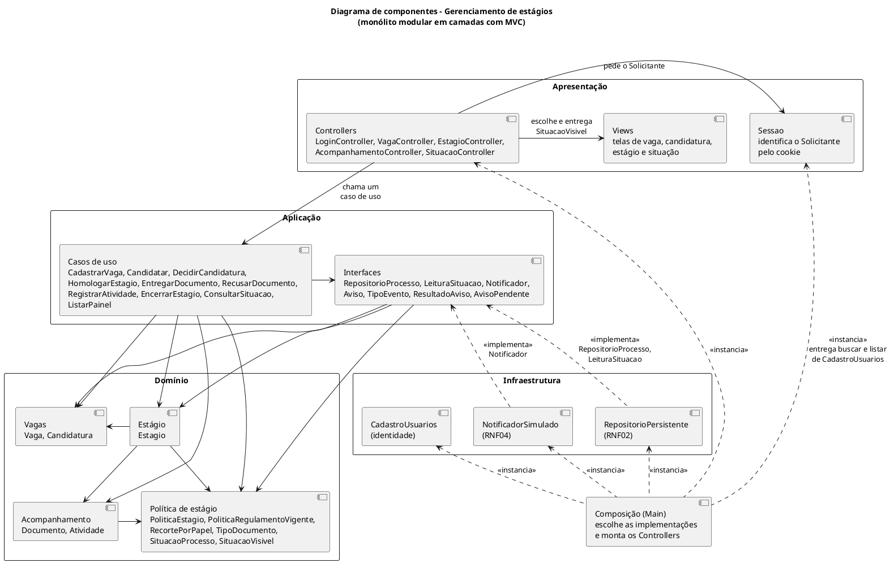

# Proposta arquitetural

O sistema é um **monólito modular em camadas, com a camada de apresentação em MVC** ([ADR-01](adr/ADR-01.md)). O processo de estágio fica num repositório só ([ADR-02](adr/ADR-02.md)) e o aviso ao estudante sai por uma interface substituível ([ADR-03](adr/ADR-03.md)). As classes e responsabilidades estão no [modelo de domínio](modelo-dominio.md); as alternativas descartadas, em [trade-offs](tradeoffs.md).



## 1. Camadas

| Camada | Responsabilidade | Contém | Pode depender de |
|---|---|---|---|
| Apresentação (MVC) | Receber a requisição HTTP, identificar o solicitante, chamar um caso de uso e exibir o resultado | Controllers e Views | Aplicação |
| Aplicação | Executar cada operação do sistema: checar permissão, carregar, chamar o domínio, gravar e avisar | Casos de uso; interfaces `RepositorioProcesso`, `LeituraSituacao`, `Notificador` | Domínio |
| Domínio | Regras do processo e do regulamento | Entidades, `PoliticaEstagio`, `RecortePorPapel`, modelos de leitura | nada |
| Infraestrutura | Tecnologia: banco, canal de aviso e identidade | `RepositorioPersistente`, `NotificadorSimulado`, `CadastroUsuarios` | Aplicação (implementa as interfaces) e Domínio (monta as entidades) |

A **composição** (`Main`) é o ponto de entrada. Ela cria as implementações da infraestrutura, entrega aos casos de uso pelo construtor e registra os Controllers nas rotas. É o único lugar que conhece as classes concretas de todas as camadas.

Regras que a revisão confere:

- uma camada só chama a de baixo; a infraestrutura só **implementa** interfaces da aplicação;
- o domínio não importa nada de aplicação, apresentação ou infraestrutura;
- Controller não tem regra de negócio, não acessa o repositório e não pergunta à política;
- View exibe o que recebe e não filtra dado (RNF01).

## 2. Módulos

Os módulos atravessam as camadas. Cada um é dono das suas entidades; outro módulo só lê pelo método público (por exemplo, `Estagio` lê `Candidatura.estaAceita()` e nunca altera o estado dela).

| Módulo | Responsabilidade | Apresentação | Aplicação | Domínio |
|---|---|---|---|---|
| Vagas | Oferta da concedente e candidatura do estudante | `VagaController` | `CadastrarVaga`, `Candidatar`, `DecidirCandidatura` | `Vaga`, `Candidatura` |
| Estágio | Homologação, orientador e encerramento | `EstagioController` | `HomologarEstagio`, `EncerrarEstagio` | `Estagio` |
| Acompanhamento | Documentos e atividades do estágio | `AcompanhamentoController` | `EntregarDocumento`, `RecusarDocumento`, `RegistrarAtividade` | `Documento`, `Atividade` |
| Política de estágio | Documentos obrigatórios, quem decide cada etapa e o que cada papel vê | — | — | `PoliticaEstagio`, `PoliticaRegulamentoVigente`, `RecortePorPapel`, `TipoDocumento`, `SituacaoProcesso`, `SituacaoVisivel` |

A **consulta de situação** (RF07) não é um módulo: ela lê as raízes de Vagas e de Estágio juntas e aplica o recorte da Política. Por isso tem Controller e casos de uso próprios (`SituacaoController`, `ConsultarSituacao` e `ListarPainel`), mas nenhuma entidade. `ListarPainel` monta a tela inicial: as vagas (oferta pública, sem dado pessoal) e os processos que o solicitante pode ver. Ele não tem filtro próprio: passa cada processo por `ConsultarSituacao`, então o RNF01 continua aplicado num ponto só (ASR3).

Dependências entre módulos do domínio (sem ciclo):

```
Estágio ──▶ Vagas, Acompanhamento, Política
Acompanhamento ──▶ Política
Vagas, Política ──▶ (nada)
```

### Organização do código

As pastas seguem primeiro a camada e, dentro dela, o módulo. A camada vem primeiro porque o repositório é um só ([ADR-02](adr/ADR-02.md)) e as interfaces da aplicação são usadas por todos os módulos.

```
src/
├── apresentacao/
│   ├── controllers/     VagaController, EstagioController,
│   │                    AcompanhamentoController, SituacaoController
│   └── views/           vagas/, estagio/, acompanhamento/, situacao/
├── aplicacao/
│   ├── vagas/           CadastrarVaga, Candidatar, DecidirCandidatura
│   ├── estagio/         HomologarEstagio, EncerrarEstagio
│   ├── acompanhamento/  EntregarDocumento, RecusarDocumento, RegistrarAtividade
│   ├── situacao/        ConsultarSituacao, ListarPainel
│   ├── interfaces/      RepositorioProcesso, LeituraSituacao, Notificador,
│   │                    Aviso, TipoEvento, ResultadoAviso, AvisoPendente
│   └── (apoio)          Solicitante, Resultado, erros, checagem de permissão,
│                        aviso depois de gravar
├── dominio/
│   ├── vagas/           Vaga, Candidatura
│   ├── estagio/         Estagio
│   ├── acompanhamento/  Documento, Atividade
│   └── politica/        PoliticaEstagio, PoliticaRegulamentoVigente, RecortePorPapel,
│                        TipoDocumento, SituacaoProcesso, SituacaoVisivel
├── infraestrutura/
│   ├── persistencia/    RepositorioPersistente
│   ├── notificacao/     NotificadorSimulado
│   └── identidade/      CadastroUsuarios (login simples)
└── main.py              composição
```

## 3. Interfaces relevantes

As interfaces são o que pode ser trocado sem reescrever o resto. Cada uma tem um contrato que vale para qualquer implementação; os mesmos testes de contrato rodam contra a implementação simulada e a real.

### `RepositorioProcesso` (aplicação → infraestrutura)

| Operação | Retorno | Contrato |
|---|---|---|
| `buscarVaga(vagaId)` | `Vaga` com as candidaturas | erro `NaoEncontrado` se não existir |
| `buscarVagaDaCandidatura(candidaturaId)` | `Vaga` | idem |
| `salvarVaga(vaga)` | — | grava a vaga e todas as candidaturas, ou nada |
| `buscarEstagio(estagioId)` | `Estagio` com documentos e atividades | erro `NaoEncontrado` se não existir |
| `buscarEstagioDaCandidatura(candidaturaId)` | `Estagio` ou nada | nada se a candidatura ainda não foi homologada; usado para impedir a segunda homologação |
| `salvarEstagio(estagio)` | — | grava o estágio, documentos e atividades, ou nada |
| `salvarAvisoPendente(aviso, motivoFalha)` | — | grava o aviso que falhou, com data |

### `LeituraSituacao` (aplicação → infraestrutura)

| Operação | Retorno | Contrato |
|---|---|---|
| `carregar(candidaturaId)` | `SituacaoProcesso` | junta vaga, candidatura e, se houver, estágio com orientador, documentos e atividades; não aplica filtro de papel |
| `listarVagas()` | lista de dados de vaga | todas as vagas; oferta pública, sem dado de estudante |
| `listarCandidaturas()` | lista de ids de candidatura | todos os ids; quem decide o que o solicitante vê é o recorte |

Implementada pela mesma classe e sobre o mesmo armazenamento do `RepositorioProcesso` (segregação de interface, não de dados).

### `Notificador` (aplicação → infraestrutura)

| Operação | Retorno | Contrato |
|---|---|---|
| `notificar(aviso)` | `ResultadoAviso`: `sucesso` ou `falha(motivo)` | nunca lança exceção; não reenvia; não desfaz nada |

`Aviso` = destinatário, `TipoEvento` (`CANDIDATURA_ACEITA`, `CANDIDATURA_RECUSADA`, `ESTAGIO_HOMOLOGADO`, `DOCUMENTO_RECUSADO`, `ESTAGIO_ENCERRADO`), id de referência e motivo opcional.

### `PoliticaEstagio` (dentro do domínio)

| Operação | Retorno |
|---|---|
| `documentosObrigatorios()` | lista de `TipoDocumento` exigidos hoje |
| `podeDecidir(etapa, papel)` | `true` ou `false` |

Não é uma fronteira de tecnologia: muda quando muda o regulamento ([ASR1](requisitos.md#asr1)).

## 4. Mecanismos de comunicação

| De → para | Mecanismo | Síncrono? |
|---|---|---|
| Navegador → Controller | HTTP: `GET` para consulta, `POST` de formulário para alteração; resposta em HTML | sim |
| Controller → caso de uso | chamada local de método | sim |
| Caso de uso → domínio | chamada local de método | sim |
| Módulo → módulo (domínio) | chamada local a método público | sim |
| Caso de uso → `RepositorioProcesso` / `LeituraSituacao` | chamada local à interface; a implementação usa SQL | sim |
| Caso de uso → `Notificador` | chamada local à interface, **depois** de gravar | sim |

Não há fila, barramento de eventos nem chamada de rede entre módulos. A única saída para fora do processo é o `Notificador`, e nesta entrega ela é simulada.

## 5. Persistência

**Tecnologia do protótipo:** banco relacional embarcado (SQLite), num arquivo único. Atende o RNF02 (os dados sobrevivem ao reinício) sem servidor de banco para instalar. A troca por um servidor (PostgreSQL, por exemplo) está analisada na [análise de evolução](evolucao.md#mudança-2--sqlite-substituído-por-postgresql).

Esquema:

| Tabela | Colunas principais | Observação |
|---|---|---|
| `usuario` | `id`, `nome`, `email`, `papel` | cadastro de identidade: nome para a concedente (ASR3) e e-mail para um notificador real |
| `vaga` | `id`, `concedente_id`, `area`, `carga_horaria_semanal`, `periodo`, `pre_requisitos`, `estado` | raiz `Vaga` |
| `candidatura` | `id`, `vaga_id`, `estudante_id`, `estado`, `motivo_recusa` | `UNIQUE(vaga_id, estudante_id)` reforça o RF02 |
| `estagio` | `id`, `candidatura_id`, `orientador_id`, `estado`, `motivo_encerramento` | raiz `Estagio`; `UNIQUE(candidatura_id)` |
| `documento` | `estagio_id`, `tipo`, `estado`, `motivo_recusa` | `tipo` é o código do `TipoDocumento`: um documento novo é uma linha nova, não uma coluna nova (ASR1) |
| `atividade` | `id`, `estagio_id`, `data`, `descricao`, `carga_horaria` | |
| `aviso_pendente` | `id`, `tipo_evento`, `referencia_id`, `destinatario_id`, `motivo`, `motivo_falha`, `criado_em` | RNF03 |

Regras de gravação:

- cada `salvarVaga` e `salvarEstagio` roda numa transação: a raiz inteira ou nada;
- cada caso de uso grava **uma** raiz (o `salvarAvisoPendente`, quando acontece, é uma escrita separada e posterior);
- `LeituraSituacao` faz a junção das tabelas numa leitura só, dentro do mesmo processo (ASR3).

## 6. Integrações externas

| Integração | Interface | Nesta entrega | Substituível por |
|---|---|---|---|
| Aviso ao estudante (RF09) | `Notificador` | `NotificadorSimulado`: guarda os avisos emitidos, registra em log e pode ser configurado para falhar, para demonstrar o aviso pendente | e-mail institucional (SMTP), REST ou SOAP da instituição |
| Identidade do usuário | sessão do Controller | login simples sobre a tabela `usuario`, sem senha real (`CadastroUsuarios`, entregue à sessão pela composição) | autenticação institucional (SSO); afeta só a apresentação, que monta o `Solicitante` |

## 7. Decisões de comunicação

- **Síncrono e local dentro do monólito.** Toda operação termina na mesma requisição. A consulta de situação junta os dados e aplica o recorte no mesmo processo, que é o que o ASR3 exige ([ADR-01](adr/ADR-01.md)).
- **Gravar antes de avisar.** O caso de uso persiste a decisão e só depois chama o `Notificador`. Se o aviso falha, a decisão fica e o caso de uso grava um `AvisoPendente` ([ADR-03](adr/ADR-03.md)).
- **Sem fila e sem outbox.** O aviso não tem garantia legal de entrega; o pendente cobre a falha. Se passar a ter, um ADR novo adota outbox, mantendo a interface ([ADR-03](adr/ADR-03.md)).
- **HTML renderizado no servidor.** As Views são páginas geradas pelo Controller, não uma aplicação separada consumindo uma API. Uma API REST para outro cliente seria um conjunto novo de Controllers chamando os mesmos casos de uso ([análise de evolução](evolucao.md#mudança-4--nova-interface-aplicativo-ou-api-rest)).

## 8. Rotas HTTP

Cada rota chama um caso de uso. O papel é o do `Solicitante` montado pela sessão; quem confere a permissão é o caso de uso, não o Controller. Nas quatro etapas de decisão, a checagem é `PoliticaEstagio.podeDecidir`. Nas demais operações, o caso de uso confere o papel e o vínculo: a concedente só decide candidatura da própria vaga, e o estudante só entrega documento e registra atividade no próprio estágio.

| Método e rota | Controller | Caso de uso | Papel | Dados |
|---|---|---|---|---|
| `POST /vagas` | `VagaController` | `CadastrarVaga` | concedente | área, carga horária semanal, período, pré-requisitos |
| `POST /vagas/{vagaId}/candidaturas` | `VagaController` | `Candidatar` | estudante | — |
| `POST /candidaturas/{id}/aceite` | `VagaController` | `DecidirCandidatura` | concedente | — |
| `POST /candidaturas/{id}/recusa` | `VagaController` | `DecidirCandidatura` | concedente | motivo |
| `POST /candidaturas/{id}/homologacao` | `EstagioController` | `HomologarEstagio` | coordenação | orientadorId |
| `POST /estagios/{id}/encerramento` | `EstagioController` | `EncerrarEstagio` | coordenação | motivo |
| `POST /estagios/{id}/documentos/{tipo}/entrega` | `AcompanhamentoController` | `EntregarDocumento` | estudante | — |
| `POST /estagios/{id}/documentos/{tipo}/recusa` | `AcompanhamentoController` | `RecusarDocumento` | coordenação | motivo |
| `POST /estagios/{id}/atividades` | `AcompanhamentoController` | `RegistrarAtividade` | estudante | data, descrição, carga horária |
| `GET /candidaturas/{id}/situacao` | `SituacaoController` | `ConsultarSituacao` | todos | — |
| `GET /` | `SituacaoController` | `ListarPainel` | todos | — |

Rotas de sessão, fora dos casos de uso: `GET /login` (lista os usuários), `POST /login` (grava o usuário escolhido num cookie) e `POST /logout`. Sem sessão, qualquer outra rota redireciona para `/login`.

Como o Controller traduz o resultado do caso de uso:

| Resultado | Status | View |
|---|---|---|
| sucesso | `303` para a tela da situação | situação atualizada |
| sucesso com `avisoPendente = true` | `303` para a tela da situação | situação atualizada e alerta "aviso ao estudante pendente" |
| dados inválidos (motivo vazio, carga horária não positiva) | `400` | formulário com a mensagem |
| papel sem permissão para a etapa | `403` | página de acesso negado |
| `AcessoNegado` na consulta (RNF01) | `403` | página de acesso negado, sem dado pessoal |
| id inexistente | `404` | página não encontrada |
| regra violada (vaga encerrada, candidatura duplicada, candidatura não aceita, estágio encerrado) | `409` | tela anterior com a mensagem da regra |

## 9. Rastreabilidade dos ASRs

| ASR | Onde a arquitetura responde | Decisão |
|---|---|---|
| [ASR1](requisitos.md#asr1): documento obrigatório e aprovador mudam sem tocar candidatura, atividade nem armazenamento | `PoliticaEstagio` no domínio; `documento.tipo` como dado | [ADR-01](adr/ADR-01.md), [ADR-02](adr/ADR-02.md) |
| [ASR2](requisitos.md#asr2): canal do aviso trocável sem mudar o registro da decisão | interface `Notificador`, chamada depois de gravar | [ADR-03](adr/ADR-03.md) |
| [ASR3](requisitos.md#asr3): RNF01 aplicado uma vez | `ConsultarSituacao` → `LeituraSituacao` → `RecortePorPapel`; Controller e View não filtram | [ADR-01](adr/ADR-01.md) |
