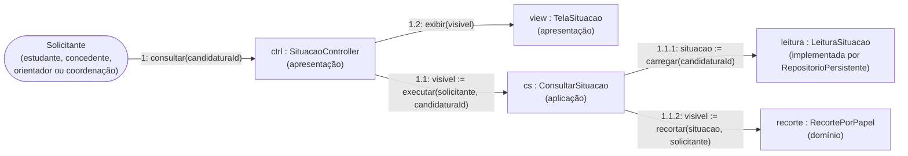

# Diagrama de comunicação - Consultar situação (RF07, RNF01, ASR3)

Mensagens numeradas na ordem de execução. O retorno aparece na própria mensagem (`resultado := operação`).

O `SituacaoController` monta o `Solicitante` (id e papel) a partir da sessão e chama o caso de uso. O recorte por papel só acontece em `RecortePorPapel`, depois que `LeituraSituacao` junta vaga, candidatura, estágio, documentos e atividades. O resultado é uma `SituacaoVisivel` ou `AcessoNegado`.

Nem o Controller nem a View filtram dado: a tela exibe exatamente o que recebeu. Nenhuma tela lê o banco por conta própria.
