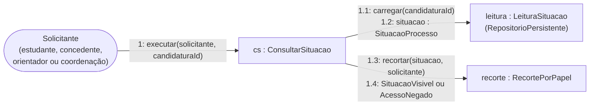

Mensagens numeradas na ordem de execução.
 

 
O recorte por papel só acontece em `RecortePorPapel`, depois que `LeituraSituacao` junta vaga, candidatura, estágio, documentos e atividades. Nenhuma tela lê o banco por conta própria.
