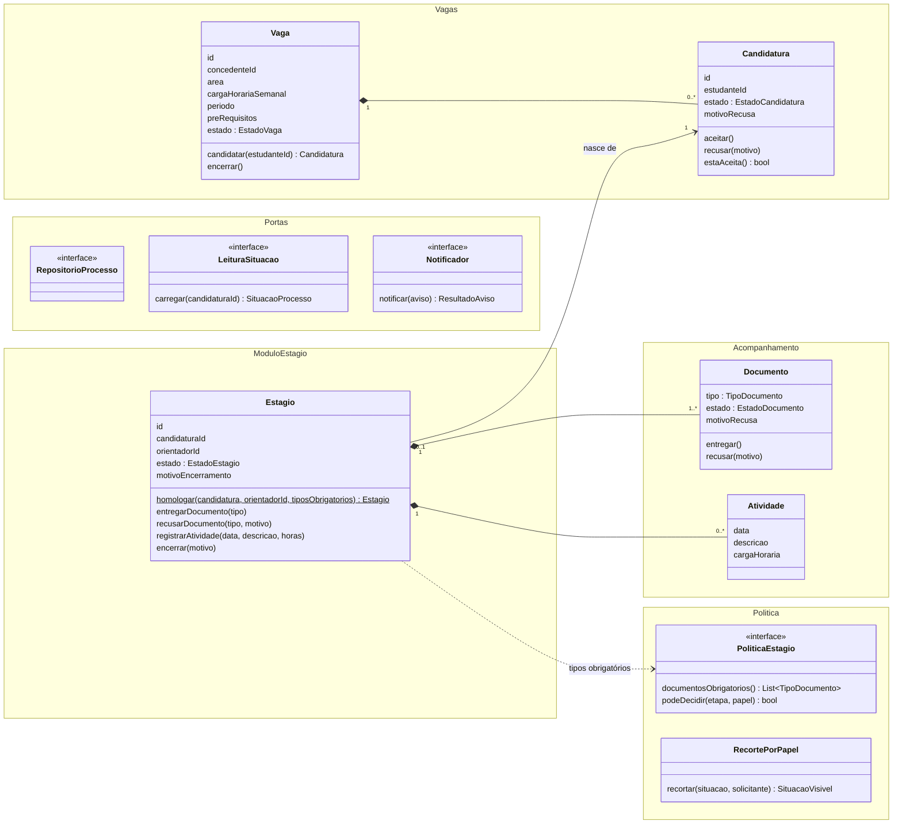

# Modelo de domínio e responsabilidades

Este documento distribui as responsabilidades do sistema entre classes e módulos. Ele segue a estrutura do [ADR-01](adr/ADR-01.md) (monólito hexagonal com quatro módulos no núcleo), o registro único do processo do [ADR-02](adr/ADR-02.md) e a porta de aviso do [ADR-03](adr/ADR-03.md). Os diagramas UML completos estão em [diagramas/](diagramas/). O diagrama abaixo é só um mapa para ler este texto.

## 1. Visão geral



Duas raízes de agregado gravam no mesmo repositório ([ADR-02](adr/ADR-02.md)):

- **Vaga**, que contém as **Candidaturas**;
- **Estágio**, que contém os **Documentos** e as **Atividades**.

O estágio guarda o `candidaturaId`, não o objeto. Assim cada ato carrega e grava só a raiz que altera. A situação (RF07) é a leitura das duas raízes juntas.

## 2. Conceitos e responsabilidades

### Módulo Vagas

**Vaga.** É a oferta da concedente (RF01).

| Responsabilidade | Requisito |
|---|---|
| Guardar área, carga horária semanal, período e pré-requisitos | RF01 |
| Começar no estado `ABERTA` e poder ser encerrada | RF01, RF02 |
| Criar a candidatura, recusando quando a vaga está encerrada ou o estudante já se candidatou a ela | RF02 |
| Saber a qual concedente pertence (`concedenteId`), dado usado pelo recorte do RNF01 | RNF01 |

**Candidatura.** É o pedido do estudante a uma vaga.

| Responsabilidade | Requisito |
|---|---|
| Transições `ENVIADA → ACEITA` e `ENVIADA → RECUSADA`, e nenhuma outra | RF03 |
| Rejeitar a recusa sem motivo | RF03 |
| Responder `estaAceita()`, consultado pela homologação | RF04 |

Estados:

```
ENVIADA ──aceitar()──────────▶ ACEITA ──(homologação cria Estágio)
   └────recusar(motivo)──────▶ RECUSADA   (não gera estágio)
```

### Módulo Estágio

**Estágio.** Existe só depois de candidatura aceita e homologada (RF04, [ADR-01](adr/ADR-01.md)).

| Responsabilidade | Requisito |
|---|---|
| Ser criado por `Estagio.homologar(...)`, que falha se a candidatura não estiver aceita | RF04 |
| Guardar o orientador designado | RF04 |
| Criar um `Documento PENDENTE` para cada tipo que a política declara obrigatório no momento da homologação | RF05, ASR1 |
| Aceitar atividade só em `EM_ANDAMENTO` | RF06, RF08 |
| Encerrar com motivo obrigatório. Depois disso, recusa atividade nova | RF08 |
| Encaminhar entrega e recusa ao `Documento` do tipo indicado | RF05 |

Estados: `EM_ANDAMENTO ──encerrar(motivo)──▶ ENCERRADO`.

### Módulo Acompanhamento

**Documento.** É um item do processo com tipo e estado, não uma etapa ([ADR-02](adr/ADR-02.md)).

| Responsabilidade | Requisito |
|---|---|
| Transições `PENDENTE → ENTREGUE`, `ENTREGUE → RECUSADO` e `RECUSADO → ENTREGUE` (reentrega) | RF05 |
| Rejeitar a recusa sem motivo e guardar o motivo | RF05 |

**Atividade.** Registro de data, descrição e carga horária (RF06). Valida que a carga horária é positiva e que a descrição não está vazia. Não conhece o estado do estágio. Essa regra fica no Estágio, que é quem tem essa informação.

### Módulo Política de estágio

**PoliticaEstagio** (interface no núcleo) e **PoliticaRegulamentoVigente** (implementação). Este é o lugar único do [ASR1](requisitos.md#asr1):

- `documentosObrigatorios()` devolve a lista de `TipoDocumento` exigidos hoje (termo de compromisso, plano de atividades, relatório);
- `podeDecidir(etapa, papel)` responde quem aprova cada etapa: `DECISAO_CANDIDATURA → CONCEDENTE`, `HOMOLOGACAO → COORDENACAO`, `RECUSA_DOCUMENTO → COORDENACAO`, `ENCERRAMENTO → COORDENACAO`.

`TipoDocumento` é um valor com código e nome, definido pela política. Não é um `enum` fixo espalhado nos casos de uso. Incluir "relatório parcial" é acrescentar um valor à política.

**RecortePorPapel.** Aplica o RNF01 em um ponto só ([ASR3](requisitos.md#asr3)). Recebe a situação completa e o solicitante (`id` e `papel`) e devolve só o que ele pode ver:

| Papel | Vínculo exigido | O que recebe |
|---|---|---|
| Coordenação | nenhum | situação completa |
| Estudante | `candidatura.estudanteId == solicitante.id` | o próprio processo completo |
| Orientador | `estagio.orientadorId == solicitante.id` | identidade, documentos e atividades do estágio que orienta |
| Concedente | `vaga.concedenteId == solicitante.id` | processo da candidatura à própria vaga, com nome do estudante |
| Qualquer outro | sem vínculo | `AcessoNegado`, sem dado pessoal |

### Portas (núcleo) e adaptadores (fora do núcleo)

| Porta | Quem usa | Adaptador desta entrega |
|---|---|---|
| `RepositorioProcesso`: `buscarVaga`, `salvarVaga`, `buscarVagaDaCandidatura`, `buscarEstagio`, `salvarEstagio`, `salvarAvisoPendente` | casos de uso que alteram estado | repositório persistente (RNF02) |
| `LeituraSituacao`: `carregar(candidaturaId)` | só `ConsultarSituacao` | mesmo adaptador e mesmo armazenamento do repositório |
| `Notificador`: `notificar(Aviso) → ResultadoAviso` | casos de uso do RF09 | `NotificadorSimulado`, que guarda os avisos e pode ser instruído a falhar ([ADR-03](adr/ADR-03.md)) |

`Aviso` = destinatário, `TipoEvento` (`CANDIDATURA_ACEITA`, `CANDIDATURA_RECUSADA`, `ESTAGIO_HOMOLOGADO`, `DOCUMENTO_RECUSADO`, `ESTAGIO_ENCERRADO`), id de referência e motivo opcional.

### Aplicação (casos de uso)

Cada operação do sistema é uma classe com um método `executar`:

| Caso de uso | Ator | Avisa? |
|---|---|---|
| `CadastrarVaga` | concedente | não |
| `Candidatar` | estudante | não |
| `DecidirCandidatura` (aceitar/recusar) | concedente | sim |
| `HomologarEstagio` | coordenação | sim |
| `EntregarDocumento` | estudante | não |
| `RecusarDocumento` | coordenação | sim |
| `RegistrarAtividade` | estudante | não |
| `EncerrarEstagio` | coordenação | sim |
| `ConsultarSituacao` | todos | não |

Roteiro comum dos casos de uso que alteram estado:

1. perguntar à política se o papel pode decidir a etapa;
2. carregar a raiz pelo repositório;
3. chamar o método de domínio (a regra está nele);
4. gravar;
5. se for evento do RF09, chamar `Notificador` **depois** de gravar. Em caso de falha, gravar `AvisoPendente` e devolver `avisoPendente = true` sem desfazer a decisão (RNF03).

`ConsultarSituacao` chama `LeituraSituacao.carregar` e depois `RecortePorPapel.recortar`. Nenhuma outra classe lê a situação.

O processo é identificado pela **candidatura**, não pelo estágio. O estudante e a concedente consultam o processo antes da homologação, quando o estágio ainda não existe. Depois, a mesma consulta já traz o estágio.

### Conceitos de apoio

As classes abaixo não têm regra de negócio própria, mas aparecem nas assinaturas e no diagrama. Cada uma tem uma responsabilidade pequena e definida.

| Conceito | Tipo | Módulo | Responsabilidade |
|---|---|---|---|
| `Solicitante` | objeto de valor (`id`, `papel`) | aplicação | Identificar quem pede cada operação. É a entrada da checagem `podeDecidir` e do `RecortePorPapel`. |
| `Papel` | enumeração | política | `CONCEDENTE`, `ESTUDANTE`, `COORDENACAO`, `ORIENTADOR`: os quatro atores do RNF01. |
| `Etapa` | enumeração | política | `DECISAO_CANDIDATURA`, `HOMOLOGACAO`, `RECUSA_DOCUMENTO`, `ENCERRAMENTO`: as etapas em que a política diz quem decide (ASR1). |
| `TipoDocumento` | objeto de valor (`codigo`, `nome`) | política | Identificar o tipo de um documento. Os valores válidos vêm de `PoliticaEstagio`, não de um `enum` no código dos casos de uso. |
| `EstadoVaga`, `EstadoCandidatura`, `EstadoEstagio`, `EstadoDocumento` | enumerações | módulo de cada entidade | Listar os estados possíveis. As transições ficam na entidade dona do estado. |
| `Aviso` | objeto de valor | portas | Levar ao `Notificador` destinatário, `TipoEvento`, referência e motivo ([ADR-03](adr/ADR-03.md)). |
| `TipoEvento` | enumeração | portas | Os cinco eventos do RF09. É enumerado para os casos de uso não montarem texto livre. |
| `ResultadoAviso` | objeto de valor | portas | `sucesso` ou `falha(motivo)`. Sem exceção, para o caso de uso decidir o aviso pendente. |
| `AvisoPendente` | registro persistido | portas | Guardar o aviso que falhou (evento, referência, destinatário, motivo da falha, data) para nova tentativa (RNF03). |
| `SituacaoProcesso` | modelo de leitura | portas | A situação completa do RF07: vaga, candidatura e, se houver, estágio com orientador, documentos e atividades. Só `LeituraSituacao` produz, só `RecortePorPapel` consome. |
| `SituacaoVisivel` | modelo de leitura | política | O resultado do recorte: o que o solicitante pode ver, ou `AcessoNegado`. É o que a interface recebe. |

### O que ficou fora do modelo, e por quê

- **Estudante, Concedente e Coordenação não são classes.** Nos requisitos, eles só agem e são identificados. Nenhum RF pede cadastro, edição ou regra sobre os dados deles. No modelo, aparecem como:
  - `estudanteId` na `Candidatura`;
  - `concedenteId` na `Vaga`;
  - `Solicitante` com o papel em cada operação.

  Criar a classe `Estudante` sem comportamento seria uma classe anêmica, só para espelhar uma tabela. O nome do estudante, que a concedente precisa ver (ASR3), vem de um cadastro de identidade atrás do repositório, não de uma entidade do núcleo.
- **Orientador é só `orientadorId` no `Estagio`.** O orientador não toma decisões no processo: só consulta (seção Atores dos requisitos). A única regra ligada a ele é "orientador vê os estágios que orienta", e ela depende apenas da comparação `estagio.orientadorId == solicitante.id` no `RecortePorPapel`. Se o regulamento der ao orientador uma decisão (por exemplo, recusar relatório), ela entra como `podeDecidir(etapa, ORIENTADOR)` na política. Mesmo assim, não precisa de uma entidade `Orientador`.
- **Não há classe "Processo".** O [ADR-02](adr/ADR-02.md) fala em "registro do processo". No modelo, esse registro é o conjunto das duas raízes (`Vaga` com candidaturas e `Estagio` com documentos e atividades), lidas juntas por `LeituraSituacao`. Uma classe `Processo` que contivesse tudo obrigaria cada ato a carregar e gravar a vaga inteira, com todas as candidaturas de outros estudantes, só para lançar uma atividade.

## 3. Justificativas GRASP

**Information Expert.** Cada regra fica com a classe que tem os dados para decidi-la:

- `Vaga` conhece seu estado e suas candidaturas, então ela recusa a vaga encerrada e a candidatura duplicada (RF02);
- `Estagio` conhece o próprio estado, então ele recusa atividade fora de `EM_ANDAMENTO` (RF06, RF08), e não o caso de uso nem a `Atividade`;
- `Documento` conhece seu estado, então ele valida as próprias transições.

**Creator.**

- `Vaga` cria `Candidatura` porque a contém (agregação).
- `Estagio.homologar` é um método de fábrica que recebe a candidatura aceita e os tipos obrigatórios. Pelo Creator puro, a criadora seria a candidatura, que tem os dados iniciais. Isso faria o módulo Vagas depender de Estágio, ao contrário da ordem do processo (o estágio nasce da candidatura, não o inverso). A fábrica no próprio `Estagio` mantém a dependência numa só direção: Estágio → Vagas.

**Controller.** Os casos de uso são controladores por operação do sistema. Não há uma fachada única "SistemaEstagio", que acumularia as nove operações e os quatro atores.

**Pure Fabrication.** `RepositorioProcesso`, `LeituraSituacao`, `Notificador` e `RecortePorPapel` não são conceitos do regulamento. Existem para tirar do domínio a persistência, o transporte e o controle de acesso.

**Indirection e Protected Variations.** As três variações previstas nos ASRs ficam atrás de uma interface estável:

- regra de documentos e aprovação atrás de `PoliticaEstagio` (ASR1);
- canal do aviso atrás de `Notificador` (ASR2);
- armazenamento atrás de `RepositorioProcesso` ([ADR-01](adr/ADR-01.md)).

**Polymorphism.** `NotificadorSimulado` e um futuro `NotificadorEmail` atendem a mesma porta. Nenhum caso de uso testa `if canal == ...`.

**Low Coupling e High Cohesion.** Esses dois padrões GRASP são o critério usado para avaliar as escolhas acima, e a seção 4 os analisa em detalhe. Dois exemplos de decisão tomada por eles:

- A regra "atividade só em andamento" fica no `Estagio`, e não na `Atividade`. Assim a `Atividade` não depende do estágio (baixo acoplamento) e o `Estagio` concentra todas as regras do próprio ciclo de vida (alta coesão).
- O RNF01 está no `RecortePorPapel`, e não no repositório. Assim o adaptador de banco não conhece papéis (baixo acoplamento) e a regra de privacidade fica num lugar só (alta coesão).

## 4. Coesão e acoplamento

Dependências entre módulos (seta = "depende de"):

```
aplicação ──▶ vagas, estágio, acompanhamento, política, portas
estágio   ──▶ vagas (lê Candidatura), acompanhamento (contém Documento/Atividade), política (TipoDocumento)
acompanhamento ──▶ política (TipoDocumento)
vagas     ──▶ (nada)
adaptadores ──▶ portas, entidades do núcleo        (o núcleo nunca depende de adaptador)
```

O grafo não tem ciclo. Os casos de uso de Acompanhamento (`EntregarDocumento`, `RegistrarAtividade`) ficam na camada de aplicação, não dentro do módulo. Isso evita o ciclo Estágio ↔ Acompanhamento.

| Elemento | Coesão | Acoplamento | Observação |
|---|---|---|---|
| `Vaga` / `Candidatura` | alta: só oferta e decisão | nenhum para fora | módulo mais estável |
| `Estagio` | alta: ciclo de vida do estágio | Vagas, Acompanhamento, Política | é o centro do processo, por isso tem mais dependências |
| `Documento` / `Atividade` | alta: estado de um item | só `TipoDocumento` | não sabem a que estágio pertencem |
| `PoliticaEstagio` | alta: só regra do regulamento | nenhum | muda com o regulamento e com nada mais |
| `RecortePorPapel` | alta: só RNF01 | só o modelo de leitura | não acessa o banco |
| Casos de uso | uma operação cada | portas por interface | não importam SQL nem HTTP |
| Adaptadores | uma tecnologia cada | portas e entidades | só eles mudam ao trocar tecnologia |

Riscos de acoplamento, já previstos no [ADR-01](adr/ADR-01.md):

- Um caso de uso que chama SQL direto deixa a porta vazia. A revisão confere a direção dos imports.
- Um módulo que mexe nos campos de outro. Por exemplo, `Estagio` alterando `Candidatura.estado`. O estágio só **lê** `estaAceita()`.
- Uma tela que filtra dados por conta própria em vez de chamar `ConsultarSituacao` duplica o RNF01 e pode divergir.

## 5. Princípios SOLID aplicados

**S (Responsabilidade única).**

- Cada caso de uso tem uma razão para mudar: a regra daquela operação.
- `RecortePorPapel` está separado de `LeituraSituacao`. Ler e decidir quem vê mudam por motivos diferentes: esquema contra regulamento de privacidade.
- `PoliticaEstagio` muda só quando muda o regulamento.

**O (Aberto/fechado).**

- Um documento obrigatório novo entra em `PoliticaRegulamentoVigente`. `Estagio`, `Candidatar`, `RegistrarAtividade` e o esquema do banco não mudam (ASR1).
- Um canal novo é um adaptador novo de `Notificador` (ASR2).

**L (Substituição de Liskov).** Qualquer `Notificador` deve:

- devolver `falha` em vez de lançar exceção;
- não reenviar nem desfazer nada.

Qualquer `RepositorioProcesso` deve gravar a raiz inteira (estágio com documentos e atividades) ou nada. Um adaptador que viola isso quebra a regra do RNF03 sem mudar nenhuma assinatura. Por isso os mesmos testes de contrato rodam contra o simulado e contra o real.

**I (Segregação de interfaces).**

- `ConsultarSituacao` depende só de `LeituraSituacao`.
- Os casos de uso de escrita dependem de `RepositorioProcesso`.
- As duas interfaces são implementadas pelo **mesmo** adaptador sobre o **mesmo** armazenamento. A separação é de interface, não de dados, então não contradiz o repositório único do [ADR-02](adr/ADR-02.md).
- `Notificador` tem um método só.

**D (Inversão de dependência).**

- Portas e política são definidas no núcleo.
- Os casos de uso recebem as portas pelo construtor.
- A composição (`Main`/ponto de entrada) escolhe `NotificadorSimulado` e o repositório concreto.
- Nos testes, os casos de uso recebem dublês (repositório em memória e notificador que conta chamadas e falha sob comando).

## 6. Pontos para o grupo confirmar

Os itens abaixo apareceram ao cruzar requisitos e ADRs. O modelo acima já toma a decisão indicada, mas convém alinhar o texto dos outros documentos:

1. **Documento recusado.** O [ADR-02](adr/ADR-02.md) diz que o documento recusado "volta a pendente". O RF05 tem o estado `RECUSADO`, com motivo. Aqui ele fica `RECUSADO` (para o motivo e o aviso fazerem sentido) e aceita reentrega direta para `ENTREGUE`.
2. **Onde fica o aviso pendente.** O RNF03 pede para "marcar" o aviso como pendente. O [ADR-03](adr/ADR-03.md) só diz que o caso de uso devolve aviso pendente. Aqui o caso de uso grava um `AvisoPendente` no repositório, numa escrita explícita depois da falha (não escondida no adaptador). Assim ele sobrevive ao reinício (RNF02) e permite a "nova tentativa manual" citada no ADR-03.
3. **Eventos do aviso.** O contexto do [ADR-03](adr/ADR-03.md) cita "homologa ou recusa um documento" e as alternativas falam em três atos. A decisão lista cinco eventos, inclusive a decisão da concedente. O modelo segue a decisão: cinco eventos e quatro casos de uso que avisam.
4. **Documentos obrigatórios de estágios já homologados.** O estágio recebe a lista vigente na homologação. A decisão sobre estágios em andamento quando o regulamento muda está na [análise de evolução](evolucao.md#mudança-3--regulamento-passa-a-exigir-relatório-parcial-asr1).
